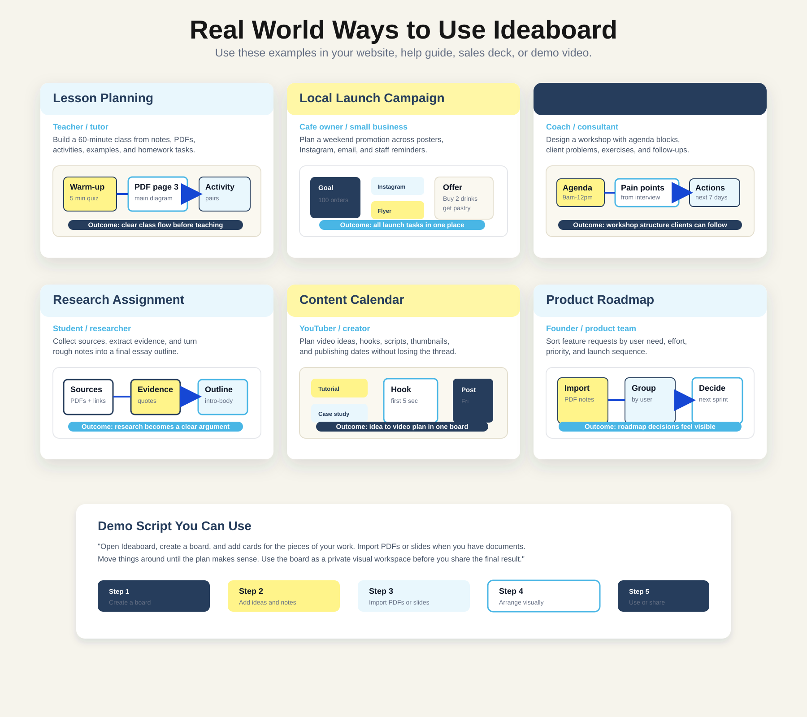
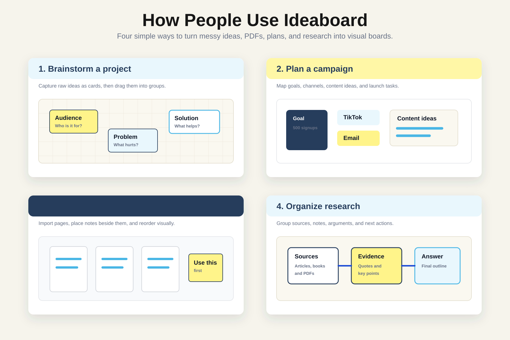

# Ideaboard

Ideaboard is a local-first visual workspace for planning, brainstorming, organizing PDFs and slides, and turning messy ideas into clear boards.

It runs on your computer and opens in your browser. It is not an Apple App Store app, Windows Store app, or cloud service. Your boards are saved locally in your browser storage.


## What You Can Do With Ideaboard

- Create visual boards for projects, lessons, campaigns, research, workshops, or content plans.
- Add movable idea cards, text blocks, slides, and framework overlays.
- Import PDF pages as visual slide tiles.
- Arrange ideas spatially on a zoomable board.
- Resize and move cards, slides, and frameworks.
- Use snap-to-grid and magnetic positioning to keep boards tidy.
- Organize boards by category.
- Generate board thumbnails for easier browsing.
- Use the app offline after setup.
- Keep work private on your own machine.

## Real World Examples



### 1. Teacher Lesson Planning

A teacher can create a board called `Week 4 Science Lesson`.

Example cards:

- Warm-up quiz
- Main concept
- PDF page 3 diagram
- Group activity
- Homework task
- Questions students may ask

How Ideaboard helps:

- Import a lesson PDF and place key pages beside teaching notes.
- Arrange class flow from left to right.
- Add sticky-note reminders beside slides.
- Keep activities, examples, and homework on one board.

Outcome:

The teacher can see the full lesson before teaching instead of jumping between documents.

### 2. Small Business Campaign Planning

A cafe owner can create a board called `Weekend Drink Promo`.

Example cards:

- Goal: sell 100 drinks
- Offer: buy 2 drinks, get 1 pastry
- Instagram post
- Flyer copy
- Staff reminder
- Email message
- Launch checklist

How Ideaboard helps:

- Put marketing channels, offer details, and tasks on one visual board.
- Group unfinished tasks together.
- Move urgent work to the top.
- Keep a simple launch checklist visible.

Outcome:

The business owner can plan a campaign without needing a complicated project management tool.

### 3. Consultant Workshop Planning

A consultant can create a board called `Client Strategy Workshop`.

Example cards:

- Client goals
- Interview notes
- Agenda block 1
- Agenda block 2
- Exercise instructions
- Discussion questions
- Follow-up actions

How Ideaboard helps:

- Turn messy discovery notes into a workshop structure.
- Arrange agenda sections in order.
- Put client pain points next to relevant exercises.
- Use the board during preparation and review.

Outcome:

The consultant can create a workshop that feels structured, visual, and easy to explain.

### 4. Student Research Assignment

A student can create a board called `History Essay Research`.

Example cards:

- Research question
- Source 1
- Source 2
- Key quote
- Evidence
- Counterargument
- Essay outline
- Final conclusion

How Ideaboard helps:

- Import research PDFs.
- Put quotes and evidence beside each source.
- Group notes into introduction, body, and conclusion.
- Turn scattered research into a clear argument.

Outcome:

The student can understand the shape of the essay before writing.

### 5. Content Creator Planning

A creator can create a board called `YouTube Video Ideas`.

Example cards:

- Tutorial idea
- Case study idea
- Hook
- Script notes
- Thumbnail concept
- Publish date
- Repurpose for TikTok

How Ideaboard helps:

- Keep content ideas visible instead of buried in notes.
- Move video ideas from draft to ready.
- Place hook, script, and thumbnail ideas beside each video topic.
- Plan a simple content calendar visually.

Outcome:

The creator can move from idea to publishable content with less friction.

### 6. Product Roadmap Planning

A founder or product team can create a board called `Next Sprint Ideas`.

Example cards:

- User request
- Bug report
- Feature idea
- Customer pain point
- Effort estimate
- Priority
- Next sprint
- Later

How Ideaboard helps:

- Group requests by user type.
- Compare priority and effort visually.
- Import meeting notes or PDF research.
- Move decided items into a sprint plan.

Outcome:

The team can make roadmap decisions with the work visible in front of them.

## More Visual Use Examples



Individual example visuals are available in:

- `marketing/use-examples/brainstorm-project.svg`
- `marketing/use-examples/marketing-campaign.svg`
- `marketing/use-examples/pdf-slides.svg`
- `marketing/use-examples/research-board.svg`
- `marketing/use-examples/real-world-detailed-examples.svg`

## How The App Works

Ideaboard is built as a local React and Vite web app.

There is no server database in the current local version. The app stores data on your machine using:

- `localStorage` for boards, cards, goal tags, slide metadata, themes, and framework settings
- IndexedDB for imported PDF page images

This makes it useful for private planning and personal workflows.

## Requirements

Install Node.js before running Ideaboard.

Recommended:

- Node.js LTS
- npm
- A modern browser such as Chrome, Safari, Edge, or Firefox

Download Node.js from:

https://nodejs.org/

## Quick Start

Clone or download the project, then install packages:

```bash
npm install
```

Start the app:

```bash
npm run dev -- --port 5180
```

Open:

```text
http://127.0.0.1:5180/
```

Keep the Terminal window open while using Ideaboard.

## One-Click Launchers

This project includes launcher files for people who do not want to type commands.

### Mac

Double-click:

```text
launch-ideaboard.command
```

If macOS blocks it:

1. Right-click `launch-ideaboard.command`.
2. Choose `Open`.
3. Click `Open` again.

### Windows

Double-click:

```text
launch-ideaboard.bat
```

The command window must stay open while the app is running.

## Detailed Install Instructions For Non-Technical Users

See:

```text
HOW_TO_INSTALL_AND_RUN.txt
```

That file explains how to run the app on Mac and Windows in plain language.

## Available Commands

```bash
npm run dev        # Start local dev server
npm run build      # Type-check and build production files
npm test           # Run tests
npx tsc --noEmit   # Type-check only
npm run lint       # Run ESLint
npm run format     # Format files with Prettier
```

Run a single test file:

```bash
npx vitest run src/lib/db.test.ts
```

## Known TypeScript Note

There is a known pre-existing TypeScript warning in `src/lib/pdfImport.ts` for the dynamic CDN import of `pdfjs-dist`.

The app loads PDF.js dynamically from a CDN at runtime. If `npx tsc --noEmit` reports `TS2307` for that dynamic import, it is expected for this local version.

## Project Structure

```text
src/
  components/       UI components such as Board, cards, slides, auth, and home screen
  hooks/            React hooks for auth, boards, slides, frames, and text blocks
  lib/              Local storage, PDF import, snapping, export/import, themes, utilities
  types/            Shared TypeScript types

marketing/
  ideaboard-promo.svg
  use-examples/

public/
  favicon.svg
```

## Privacy

Ideaboard is local-first.

In the current version:

- There is no required cloud account.
- Passwords are ignored by the local-only auth screen.
- Boards persist locally under a fixed local user ID.
- Supabase files exist in the repo but are not used by the local app.

Important:

Browser storage can be cleared by the browser or user. Export important work if you need a backup.

## Suggested Demo Script

Use this simple demo when showing Ideaboard to someone:

> Open Ideaboard, create a board, and add cards for the pieces of your work. Import PDFs or slides when you have documents. Move things around until the plan makes sense. Use the board as a private visual workspace before you share the final result.

## Who Ideaboard Is For

Ideaboard is useful for:

- Teachers and tutors
- Students and researchers
- Coaches and consultants
- Small business owners
- Content creators
- Solo founders
- Product teams
- Anyone who thinks better visually

## License

No license has been selected yet.

Before sharing publicly or accepting outside contributions, choose a license such as MIT, Apache-2.0, GPL, or a custom proprietary license.
