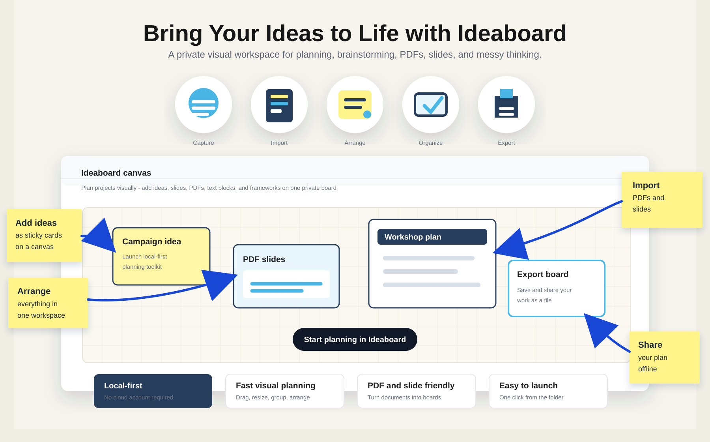
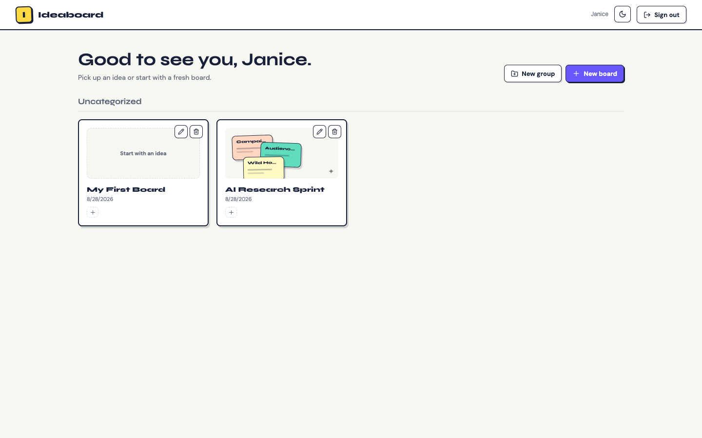
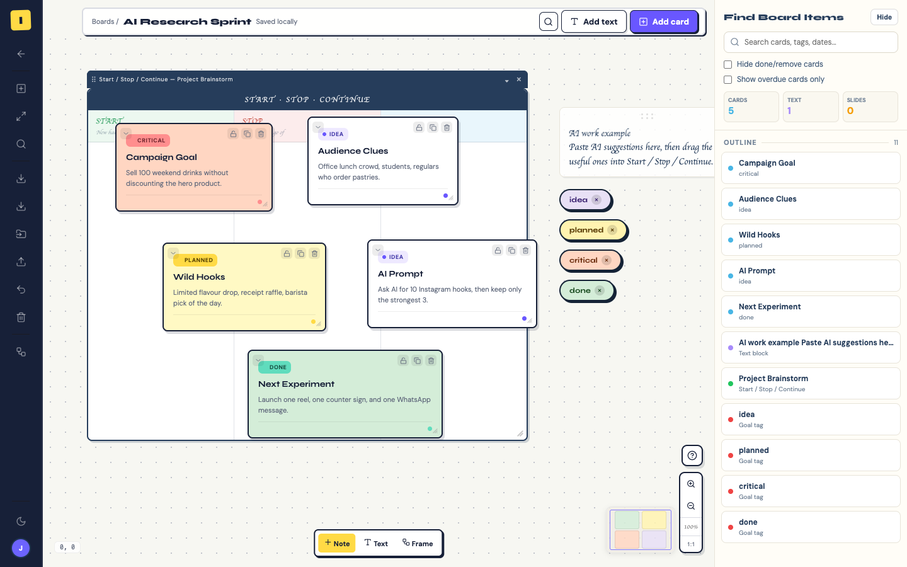
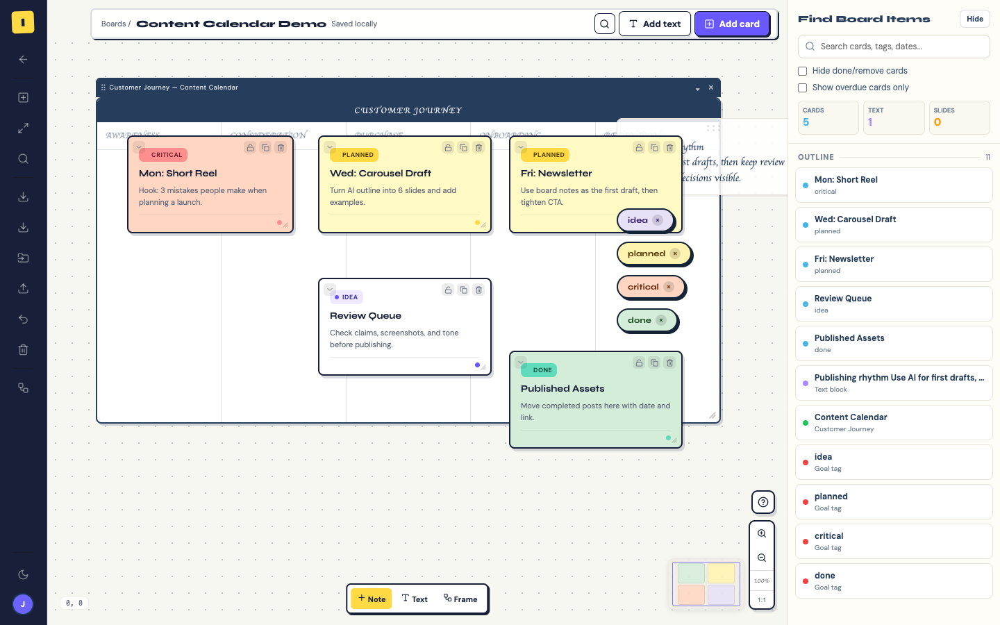
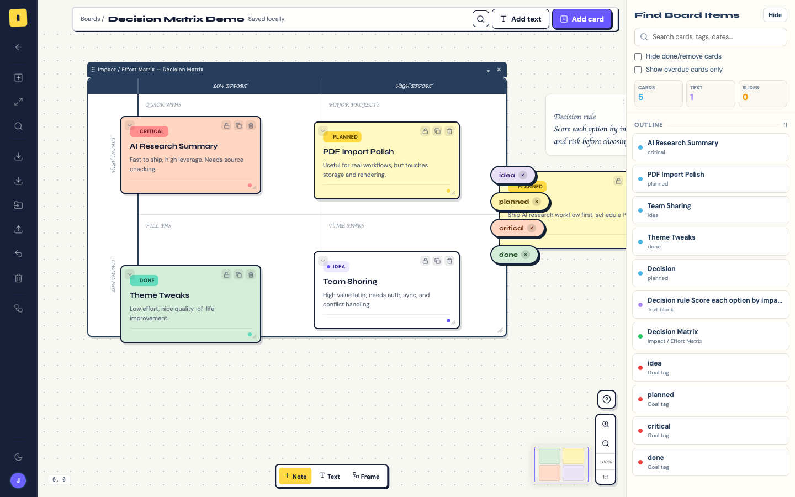

# Ideaboard

A local-first visual workspace for brainstorming, research, planning, and designing your own thinking frameworks. Keep notes, documents, goals, and frameworks together on a zoomable board.

**[Download the source ZIP](https://github.com/janiceho96/ideaboard3/archive/refs/heads/main.zip)** · [Windows setup](#windows-download-and-run) · [Mac setup](#mac-install-the-desktop-app) · [Plain-language guide](HOW_TO_INSTALL_AND_RUN.txt)

The current download is source code. Windows runs the browser version; there is no Windows `.exe` or `.msi` installer. The native Mac app is available by building this project.



## Platform support

| Feature | Windows / browser | Mac desktop app |
| --- | --- | --- |
| Boards, notes, canvas text, goals, pan and zoom | Yes | Yes |
| Built-in frameworks and manual custom framework design | Yes | Yes |
| Grid, step-by-step, matrix, and cycle layouts | Yes | Yes |
| PDF, image, Markdown, and text imports | Yes | Yes |
| Workspace and whiteboard backup / restore | Yes | Yes |
| AI-generated board drafts and framework designs | Not available | Requires a configured OpenAI API provider |
| On-device OCR for images and scanned pages | Not available | Yes |
| Standalone window without a terminal | Not available | Yes, after installation |

No sign-in is required. Core board work stays on your device. AI generation needs an internet connection, an API key, and may incur provider charges.

## Windows: download and run

1. Install **Node.js 24 LTS**, including npm, from the [official Node.js download page](https://nodejs.org/en/download). Reopen any command windows after installation.
2. Download the [source ZIP](https://github.com/janiceho96/ideaboard3/archive/refs/heads/main.zip), or use GitHub's **Code → Download ZIP**.
3. Right-click the ZIP and choose **Extract All**. Open the extracted `ideaboard3-main` folder. Do not launch from inside the ZIP.
4. Double-click **`launch-ideaboard.bat`**. On the first run it installs dependencies, which requires internet access.
5. Ideaboard opens at **http://127.0.0.1:5174/ideaboard.html** in your browser. Keep the command window open while using it.
6. To stop the server, press **Ctrl+C** in the command window. Run the launcher again whenever you want to use Ideaboard.

This starts the browser app; it does not install a Windows desktop application. Keep using the same browser profile and address to find your saved boards.

### Manual Windows startup

Open the extracted folder in File Explorer, type `cmd` in the address bar, and press Enter. In **Command Prompt**, run:

```bat
node --version
npm --version
npm ci
npm run dev -- --host 127.0.0.1 --port 5174 --strictPort --open /ideaboard.html
```

If port 5174 is occupied, stop the other Ideaboard command window and retry. The launcher keeps a fixed address because changing it would select a different browser workspace.

## Mac: install the desktop app

Building from source requires **macOS 13 or later**, Node.js 24 LTS/npm, and full Xcode with an **Apple Development signing certificate** configured. The installer checks for this certificate before replacing an existing app.

1. Download and extract the [source ZIP](https://github.com/janiceho96/ideaboard3/archive/refs/heads/main.zip), or clone the repository.
2. Double-click **`macOS/install-ideaboard-mac.command`**. If Finder blocks opening it, right-click the file and choose **Open**. Alternatively, run this from Terminal in the extracted project folder:

   ```bash
   zsh macOS/install-ideaboard-mac.command
   ```

3. Open **`~/Applications/Ideaboard.app`**, in your home folder's Applications directory. You can keep it in the Dock.

The installed app bundles its interface and opens in its own window. Node.js, Xcode, and a terminal are not needed for everyday use after installation.

### Updating the Mac app

Quit Ideaboard, download the updated source, and run the installer again. It replaces the same `~/Applications/Ideaboard.app`. Previous versions are preserved as verified ZIPs in:

```text
~/Library/Application Support/Ideaboard/App Backups
```

Updates retain the app identity and local workspace address. Do not change the native app's saved local port to work around a startup problem; your workspace is associated with that address.

### Browser version on Mac

Double-click **`launch-ideaboard.command`**, or use the development commands below. This launcher opens the browser version and does not create or replace the native app. Keep its terminal window open.

## Design a custom framework

Open **Add Frame → Design a framework**.

1. Describe the decision, investigation, or process you want to organize.
2. Choose **Idea grid**, **Step-by-step**, **2 × 2 matrix**, or **Learning cycle**.
3. Use **Add Markdown or text** to import a reference file directly, or select existing board material. Each item shows its availability and a text preview. Empty items and pictures without extracted text cannot be included. Your brief alone is enough to start.
4. In the Mac app, choose **Design with AI**. Progress shows when the request starts and when a response arrives; **Stop** keeps your brief and edits. In either version, you can add and edit sections manually.
5. Review the live preview, section names, and writing prompts. Choose **Save framework** for your library, or **Save & add to board**.

A matrix has exactly four sections; other layouts support two to eight. Reference material is limited to 12 text items and a 24,000-character request budget. Sharing selected material requires explicit consent, and changing the selection resets that consent.

Unsaved designs recover locally after closing or restarting. Sharing consent is not restored automatically. Editing a library template does not change previously placed frames: each placed frame keeps its own saved template snapshot.

## Board Assistant and source material

In the Mac app, open **AI Settings** to configure the OpenAI provider, then open **Board Assistant**. The API key is stored in macOS Keychain.

Chat can propose colored text highlights in notes and framework sections, status/date changes, note arrangement, grouping, and locking. Select the relevant note sources or a framework with writing, send the command, review its proposal, then choose **Apply changes**. Highlighting preserves your words; Undo restores the previous writing. Framework writing displays formatted Markdown between edits. See the [command evaluation and sample prompts](docs/testing/assistant-command-evaluation.md) for tested coverage.

To create a completely new framework from chat, select your Markdown material in **Add context** and send a prompt such as:

> Use the selected Markdown document to design a reusable custom framework. Create 4–6 sections with clear names and practical writing questions. Keep the sections empty for me to complete.

For broader prompt testing, see the [300-request diagnostic library](docs/testing/assistant-generation/README.md), with hypothesis-based cases, reference outcomes, live-provider validation, and documented limits. The library includes desired behaviors that the current assistant does not yet support reliably.

The assistant previews the custom structure without changing your board. Choose **Edit & save framework** to review its names, layout, and writing questions, then save it to your library or add it to the board. Unfinished custom drafts recover in the assistant after reopening. Instructions inside imported documents are reference material, not commands for the assistant to execute.

- Draft a board, fill or expand a framework, or revise a note using an explicit goal and selected context.
- Continue a separate local assistant conversation on each board.
- Review suggested replacements before applying them. Undo an assistant change while its affected writing is unchanged.
- Ask to move a named note relative to another, or delete explicitly named notes after confirming. These local board actions do not send note content to the provider.
- Open **Context → Add PDF, image, Markdown, or text**, or use the board's import button, to add reference material.

Notes, canvas text, goals, framework writing, imported text, and searchable PDF pages can provide text context. Images and scanned PDF pages can use **Extract text** for OCR on the Mac. Board Assistant can also send individually selected images for visual reading; the **framework designer uses extracted text only**, not original pictures.

AI requests can include your message, recent conversation, selected material, and authorized target writing after sharing is confirmed. OCR itself runs on the Mac. Supported imports are PDF, `.md`, `.markdown`, `.txt`, PNG, JPEG, and WebP. Office document imports are not implemented.

## Save, back up, and move your workspace

Boards are stored locally using `localStorage` and IndexedDB. The Mac app uses its own WebKit profile; each browser profile and local address has separate storage.

- On the home screen, use **Export workspace backup** to back up the whole workspace, and **Import workspace backup** to restore or transfer it.
- On a board, use **Export full whiteboard as JSON backup** for that board.
- To move work from Windows or a browser into the Mac app, export in the original workspace, open the Mac app, and import the JSON backup. The original copy remains in place.

Workspace backups include locally stored board data, framework templates, imported source text, and saved slide images. They contain your work, so keep them somewhere you trust. Make a backup before clearing app/browser storage or switching browser profiles.

## Example boards

Use Ideaboard for a lesson plan, research sprint, cafe campaign, creator calendar, workshop, or product decision. Add cards and documents, choose a framework, and arrange the material so the next action is visible.

### Board dashboard



### Project brainstorm



### Content calendar



### Decision matrix



## Development

Clone the repository and install the locked dependencies:

```bash
git clone https://github.com/janiceho96/ideaboard3.git
cd ideaboard3
npm ci
npm run dev -- --host 127.0.0.1 --port 5174 --strictPort --open /ideaboard.html
```

Node.js 24 LTS is recommended. Vite accepts Node 20.19 or Node 22.12 and later supported releases; see the [Vite requirements](https://vite.dev/guide/#scaffolding-your-first-vite-project).

| Command | Purpose |
| --- | --- |
| `npm run dev` | Start Vite for development |
| `npm run build` | Type-check and build the landing page and board app |
| `npm test` | Run Vitest tests |
| `npx vitest run src/lib/customFrameworks.test.ts` | Run one relevant test file |
| `npm run lint` | Run ESLint |
| `npx tsc --noEmit` | Type-check without building |

The production build bundles PDF.js and fonts. Core board editing and PDF rendering do not need an external CDN after the app and its assets have loaded. AI generation requires the provider connection.

```text
src/components/    Board, notes, assistant, framework designer, and home screen
src/hooks/         Board, frame, slide, and text state
src/lib/           Storage, assistant validation, imports, backups, and utilities
src/types/         Shared application types
macOS/             Native Mac app, installer, assets, and native contract checks
marketing/         Public product illustrations and example screenshots
```

There is no application server database or required cloud account. The unused Supabase scaffolding does not power the local workspace.

## Troubleshooting

- **Node or npm not found:** install Node.js LTS, then reopen the command window.
- **Dependency installation fails:** check the network connection and retry `npm ci` from the extracted folder. Do not continue with a partial installation.
- **Browser does not open:** with the launcher running, visit http://127.0.0.1:5174/ideaboard.html.
- **Boards appear missing:** check the app, browser profile, and address. Use export/import when switching environments.
- **AI unavailable on Windows:** manual framework design and core board tools work there; the native AI bridge and OCR are currently Mac-only.
- **Mac installer cannot sign:** configure an Apple Development identity in Xcode, then retry. The installer preserves the existing app when prerequisites fail.
- **Mac local address unavailable:** restore the loopback address reported by the startup error rather than switching the saved workspace port.

## License

No license has been selected yet. The repository does not currently grant a separate open-source license.
